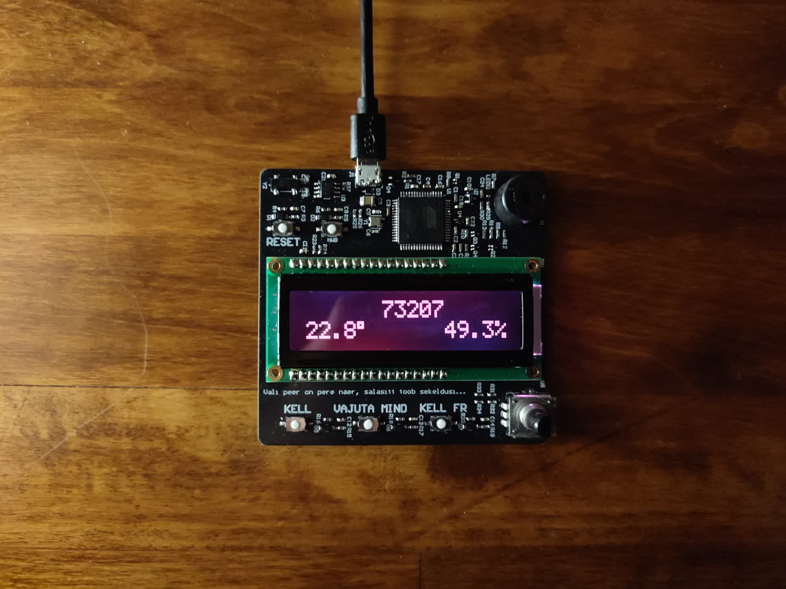
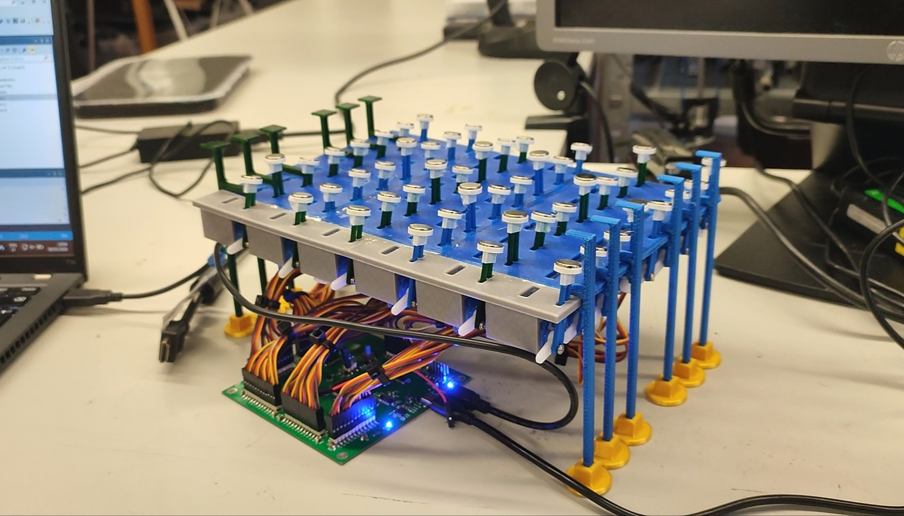
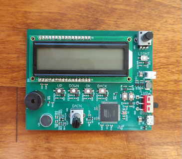
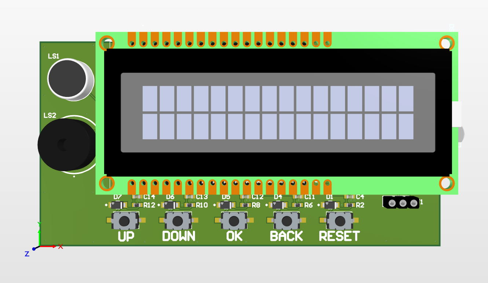
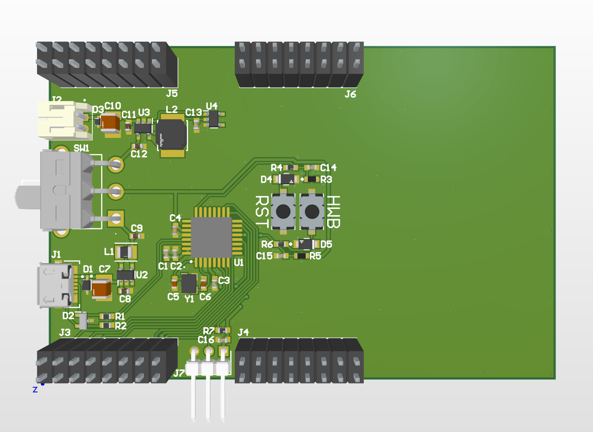

## Here are quick links to electronics projects I have completed or am working on.

### Dumb Clock
> State of the project: completed

Further info about this project can be found [here](link).

### Ferrofluid Display
> State of the project: completed

Further info about this project can be found [here](link).

### Pitch Identifier
> State of the project: revised

Further info about the failed version can be found [here](link) and the revised version can be found [here](link).

Failed version             |  Revised version
:-------------------------:|:-------------------------:
  |  

### Remote Weather Station
> State of the project: planning

Further info about this project can be found [here](link).

MCU and power             |  LoRa
:-------------------------:|:-------------------------:
  |  

