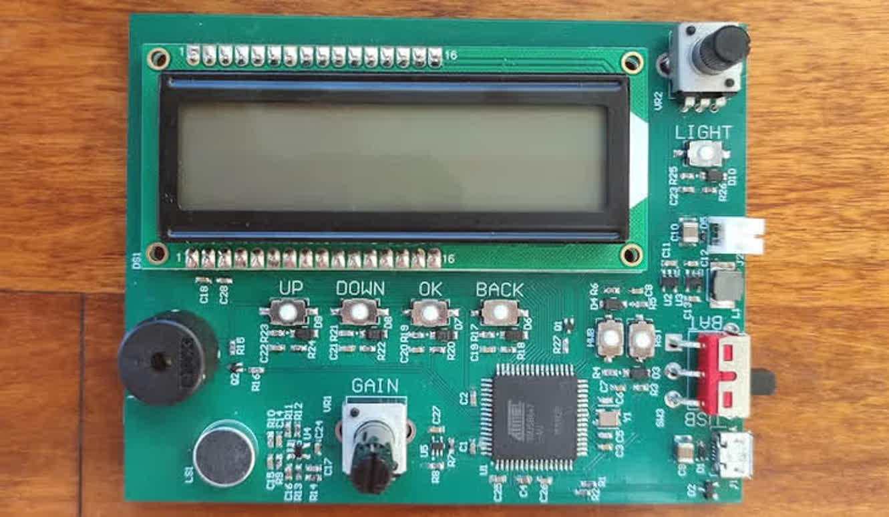
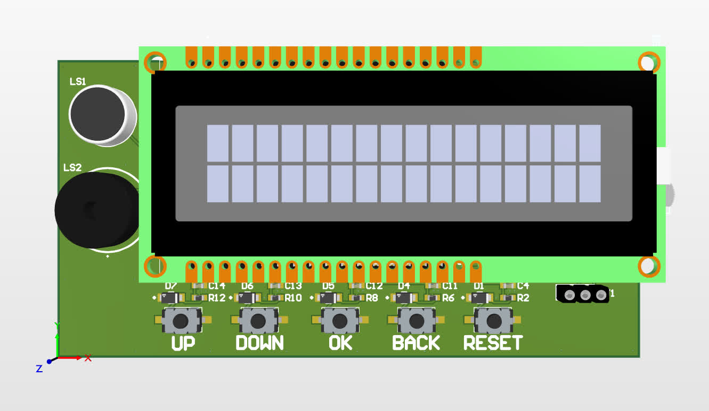
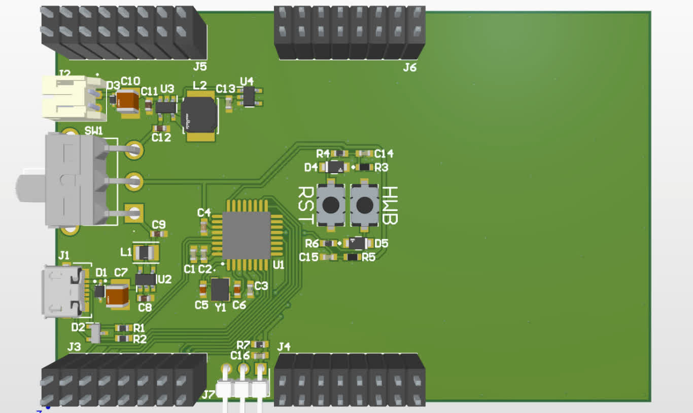
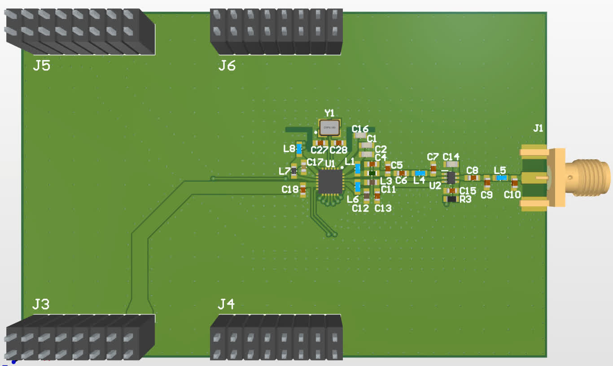

## Electronics projects I have completed or am working on:

### Dumb Clock

Further info about this project can be found [here](https://github.com/k3idi/Dumb-Clock).

### Ferrofluid Display

Further info about this project can be found [here](https://github.com/k3idi/Ferrofluid-Display).

### Pitch Identifier

Further info about the failed version can be found [here](https://github.com/k3idi/Pitch-Identifier) and the revised version can be found [here](https://github.com/k3idi/Pitch-Identifier-Revised).

Failed version             |  Revised version
:-------------------------:|:-------------------------:
  |  

### Remote Weather Station

Further info about this project can be found [here](https://github.com/k3idi/Remote-Weather-Station).

MCU and power             |  LoRa
:-------------------------:|:-------------------------:
  |  

